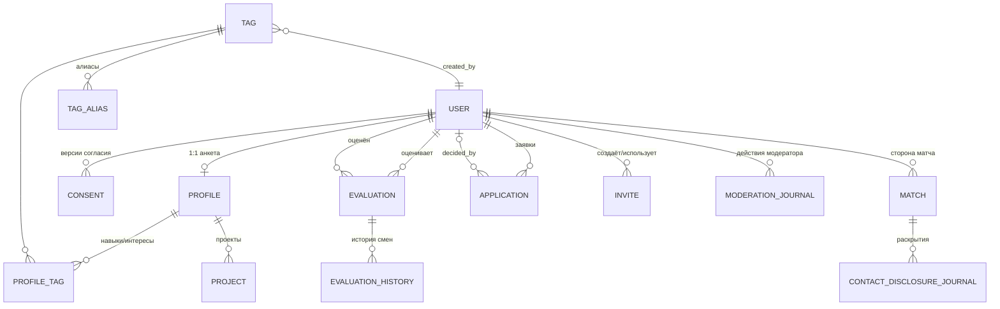

# Архитектура 01. Доменная модель (ER)

Roadmap 2.1. Вход: spec 1.1 ([README](../../README.md), цепочка 01–07).
Статус: accepted (2026-10-30, опросник [07](07-approval-form.md): Q-5.1…Q-5.4). Суждения помечены `[предположение]`, `[умозаключение]`.

## Сущности

Перечень задан roadmap 2.1: Анкета, Тег + алиасы, Оценка, Матч, Заявка, Приглашение, Журнал раскрытия контактов.
Добавлены производные сущности, без которых FR не реализуемы: Пользователь (роли Кандидат/Участник/Модератор), Проект (элемент списка `projects`), Согласие (FR-16), Журнал решений модератора (NFR-10).

### User (Пользователь)

Telegram-аккаунт, прошедший аутентификацию через `initData` (NFR-7). Один пользователь — один Telegram user id.

| Атрибут | Тип | Примечание | Трассировка |
|---|---|---|---|
| `id` | uuid | PK | — |
| `telegram_user_id` | bigint, unique | Идентификатор Telegram; часть контакта при скрытом username | FR-8, глоссарий «Telegram-контакт» |
| `telegram_username` | text, null | Может отсутствовать/меняться; хранить как снапшот `[предположение]` | FR-8 |
| `role` | enum: `candidate`, `member`, `moderator` | Кандидат → Участник после онбординга; модератор — конфигурация владельцем | FR-13, FR-15, глоссарий |
| `access_state` | enum: `none`, `invited`, `approved`, `onboarded`, `rejected` | Допуск до онбординга (приглашение или одобрение). `none` — начальное состояние (первый вход, нет ни приглашения, ни заявки); переход `rejected` → повторная подача заявки разрешена, при одобрении новой заявки состояние → `approved` (Q21, ревью F14) | FR-13, NFR-9 |
| `created_at`, `deleted_at` | timestamptz | `deleted_at` — мягкое удаление при удалении анкеты | FR-17 |

### Profile (Анкета)

1:1 с User. Поля — по таблице «Поля анкеты» в 03.

| Атрибут | Тип | Ограничения | Трассировка |
|---|---|---|---|
| `user_id` | uuid, PK/FK | 1:1 к User | — |
| `first_name` | text | 2–64, обязательное | 03, поле 1 |
| `last_name` | text, null | 0–64 | 03, поле 2 |
| `location` | text, null | 2–64; нормализация (регистр, `ё`→`е`, пробелы) — хранить и исходное, и нормализованное значение `[предположение]` | 03, поле 7; FR-11 |
| `meeting_format` | enum: `online`, `offline`, `any` | обязательное, без default | 03, поле 8 |
| `is_searchable` | bool | `false`, если после отзыва тега анкета осталась без навыков (исключается из поиска и колод до исправления) | FR-4 |
| `updated_at` | timestamptz | Для инвалидации поискового индекса (изменения ≤ 1 мин) | FR-3 |

Вне модели: аватар — ссылка на профиль Telegram, не хранится как загружаемое поле (Q24); видимость аватара/контакта/имени до матча — правило сервисного слоя (FR-14), а не атрибут.

### Tag (Справочник тегов) + TagAlias

Единый справочник для навыков и обоих типов интересов (01 «Справочник тегов»). Анкета хранит только ссылки на теги, свободных строк вне справочника нет. При ручном вводе значение нормализуется (регистр, `ё`→`е`, пробелы) и ищется по canonical и алиасам: при совпадении привязывается существующий тег, новый тег создаётся только при отсутствии совпадения и действует сразу (FR-4, уточнено владельцем 2026-10-30, Q-5.3).

| Атрибут | Тип | Примечание | Трассировка |
|---|---|---|---|
| `id` | uuid | PK | — |
| `canonical` | text | 2–64; каноническое написание | FR-4, 03 поле 3 |
| `normalized` | text, unique | нижний регистр, `ё`→`е`, сжатые пробелы; ключ дедупликации | FR-10 |
| `status` | enum: `active`, `revoked` | Отзыв модератором | FR-4 |
| `created_by` | FK User | Автор тега — получает уведомление при отзыве | FR-4, NFR-12 |

**TagAlias**: `tag_id` FK, `alias` text, `normalized` text, unique (`normalized`). Алиасы — механизм синонимов поиска (`Kafka`/`kafka`/`Кафка`) (FR-10, Q18).

### ProfileTag (связь Анкета ↔ Тег)

| Атрибут | Тип | Примечание | Трассировка |
|---|---|---|---|
| `profile_id`, `tag_id` | FK | PK составной | — |
| `kind` | enum: `skill`, `professional_interest`, `personal_interest` | Один тег может быть у одной анкеты в разных ролях → PK: (`profile_id`, `tag_id`, `kind`) `[предположение]` | 03, поля 3, 5, 6 |

Ограничения целостности (проверка в сервисном слое): ≥1 `skill` на анкету (FR-2/FR-3); лимиты NFR-5 (≤30 навыков, ≤30 интересов каждого типа); без дубликатов.

### Project (элемент списка `projects`)

| Атрибут | Тип | Примечание | Трассировка |
|---|---|---|---|
| `id`, `profile_id` | uuid, FK | — | — |
| `text` | text | 2–256 | 03, поле 4 |
| `position` | smallint | Порядок в анкете `[предположение]` | — |

Лимит ≤20 на анкету (NFR-5). Проекты — свободный текст, не теги (участвуют в полнотекстовом поиске, FR-10).

### Evaluation (Оценка)

Одна сущность для оценок из колоды и из поиска (FR-12).

| Атрибут | Тип | Примечание | Трассировка |
|---|---|---|---|
| `evaluator_id`, `target_id` | FK User | PK составной; `evaluator_id != target_id` (своя анкета не оценивается `[умозаключение]`) | FR-6, FR-10 |
| `value` | enum: `interested`, `not_interested` | «интересно» / «не интересно» | FR-6 |
| `source` | enum: `deck`, `search` | Источник первой оценки; при смене оценки не перезаписывается `[предположение]` | FR-12 |
| `updated_at` | timestamptz | Смена оценки разрешена; время последней оценки — база 30-дневного исключения из колоды | FR-9, Q17 |

Инварианты: входящее «интересно» не раскрывается до взаимности — фильтрация в API (FR-7); снятие «интересно» после матча не отзывает контакт (FR-12).

### EvaluationHistory (История оценок)

Утверждено владельцем 2026-10-30 (Q-5.1): хранить историю смен оценок.

| Атрибут | Тип | Примечание | Трассировка |
|---|---|---|---|
| `id` | uuid | PK | — |
| `evaluator_id`, `target_id` | FK User | Пара оценки | FR-12 |
| `value` | enum: `interested`, `not_interested` | Новое значение | FR-6 |
| `changed_at` | timestamptz | Момент смены | FR-12 |

Запись добавляется при каждой смене `Evaluation.value` (первая оценка тоже фиксируется). При удалении анкеты удаляется вместе с оценками (FR-17).

### Match (Матч)

| Атрибут | Тип | Примечание | Трассировка |
|---|---|---|---|
| `id` | uuid | PK | — |
| `user_low`, `user_high` | FK User | Упорядоченная пара (low < high), unique — один матч на пару | FR-7 |
| `state` | enum: `active`, `contact_unavailable` | `contact_unavailable` — после удаления анкеты одной из сторон | FR-17 |
| `created_at` | timestamptz | Момент взаимности (вторая оценка «интересно») | FR-7 |

Контакт не копируется в Match: читается из User при выдаче раздела «Матчи» (FR-8) `[предположение]`; журнал раскрытия фиксирует сам факт выдачи (ниже).

### Application (Заявка)

| Атрибут | Тип | Примечание | Трассировка |
|---|---|---|---|
| `id`, `candidate_id` | uuid, FK User | Повторная подача после отклонения — новая запись; история всех подач хранится (утверждено владельцем 2026-10-30, Q-5.2) | FR-13, Q21 |
| `state` | enum: `pending`, `approved`, `rejected` | — | FR-15 |
| `decided_by`, `decided_at` | FK User, timestamptz, null | Модератор и момент решения | FR-15 |

Уведомления об одобрении/отклонении — NFR-12 (транспорт — ADR-2, вне ER).

### Invite (Ссылка-приглашение)

| Атрибут | Тип | Примечание | Трассировка |
|---|---|---|---|
| `id` | uuid | PK | — |
| `token` | text, unique | Случайный, неугадываемый `[предположение]` | FR-13 |
| `created_by` | FK User | Модератор | FR-15 |
| `used_by`, `used_at` | FK User, timestamptz, null | Одноразовость: гаснет после первого завершённого онбординга; повторный переход отклоняется | FR-13, Q6 |

Срок действия не ограничен (FR-13) — поля `expires_at` нет.

### Consent (Согласие)

| Атрибут | Тип | Примечание | Трассировка |
|---|---|---|---|
| `user_id`, `document_version` | FK, text | PK составной; версия текста согласия `[предположение]` | FR-16 |
| `granted_at` | timestamptz | Без записи онбординг не завершается | FR-16 |

### ContactDisclosureJournal (Журнал раскрытия контактов)

| Атрибут | Тип | Примечание | Трассировка |
|---|---|---|---|
| `id` | uuid | PK | — |
| `match_id` | FK | Какой матч | FR-8 |
| `subject_id`, `recipient_id` | FK User | Чей контакт → кому раскрыт | FR-8 |
| `disclosed_at` | timestamptz | — | — |

Хранение 1 год, независимо от удаления анкеты (NFR-10) → FK на User не должны блокировать удаление: хранить `telegram_user_id` денормализованным снапшотом, FK отсутствует или `ON DELETE` не применяется `[предположение]`.

### ModerationJournal (Журнал решений модератора)

| Атрибут | Тип | Примечание | Трассировка |
|---|---|---|---|
| `id` | uuid | PK | — |
| `moderator_id` | FK User | — | FR-15 |
| `action` | enum: `application_approved`, `application_rejected`, `invite_created`, `tag_revoked` | — | FR-4, FR-15 |
| `target_type` | enum: `application`, `invite`, `tag` | Тип объекта решения (ревью F17) | — |
| `target_id` | uuid | ID заявки/приглашения/тега | — |
| `created_at` | timestamptz | Хранение 1 год | NFR-10 |

## ER-диаграмма (Mermaid)

## Матрица трассировки сущность → требования

| Сущность | FR | NFR | UC |
|---|---|---|---|
| User | FR-7, FR-8, FR-13, FR-17 | NFR-7, NFR-9 | UC-1, UC-6, UC-7 |
| Profile | FR-1…FR-3, FR-14 | NFR-5 | UC-1, UC-2 |
| Tag, TagAlias | FR-4, FR-10 | NFR-12 | UC-1, UC-2, UC-5 |
| ProfileTag | FR-2…FR-4 | NFR-5 | UC-1, UC-2 |
| Project | FR-10 (поиск по проектам) | NFR-5 | UC-1, UC-2, UC-5 |
| Evaluation | FR-6, FR-9, FR-12 | — | UC-3, UC-5 |
| EvaluationHistory | FR-12 | — | UC-3, UC-5 |
| Match | FR-7, FR-8, FR-12, FR-17 | NFR-8 | UC-4, UC-7 |
| Application | FR-13, FR-15 | NFR-12 | UC-1 (E2), UC-6 |
| Invite | FR-13, FR-15 | NFR-9 | UC-6 |
| Consent | FR-16 | NFR-10 | UC-1 |
| ContactDisclosureJournal | FR-8 | NFR-10 | UC-4 |
| ModerationJournal | FR-4, FR-15 | NFR-10 | UC-1 (3а), UC-6 |

Номера UC — по [05-use-cases](../requirements/05-use-cases.md) (сверено 2026-10-30).

## Открытые вопросы к владельцу

1. ~~История смен оценок~~ — хранить (EvaluationHistory, утверждено 2026-10-30).
2. ~~История заявок~~ — хранить все подачи (утверждено 2026-10-30).
3. ~~Ручной ввод и теги~~ — подтверждено с уточнением (2026-10-30): ручной ввод нормализуется и ищется по canonical+алиасам; новый тег создаётся только при отсутствии совпадения.
4. ~~Журналы: отдельные таблицы или единый audit-log~~ — отдельные таблицы (утверждено 2026-10-30).

## Риски

| Сeverity | Риск | Митигация |
|---|---|---|
| medium | `tg://user?id` при скрытом username `[непроверено]` — влияет только на формат выдачи контакта, не на схему | спайк [tg-user-link](../spikes/tg-user-link.md); схема хранит и username, и user id |
| low | Изменение username в Telegram делает снапшот устаревшим | обновление при каждом входе через `initData` `[предположение]` |
| low | Удаление User ломает FK в журналах с годовым хранением | денормализованный снапшот `telegram_user_id` в журналах |

Статус: accepted (2026-10-30). См. [roadmap](../roadmap.md) фаза 2.
