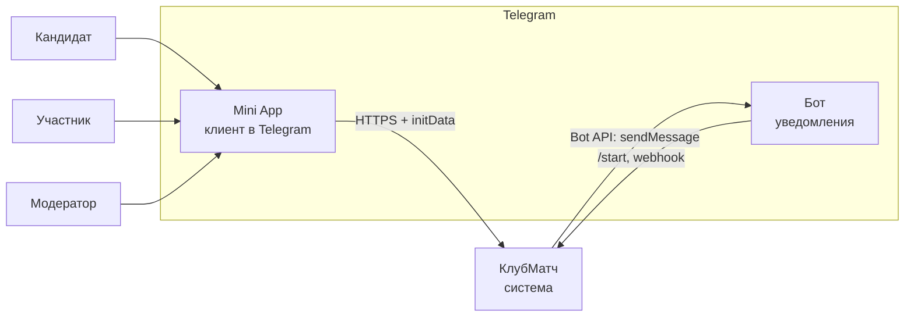
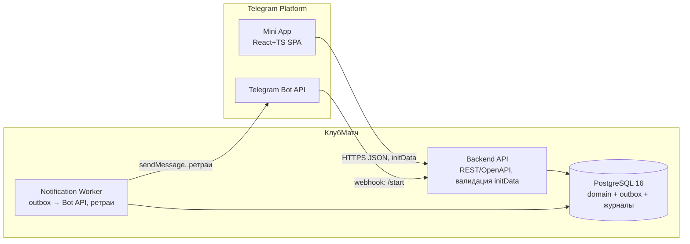

# Архитектура 02. C4: контекст и контейнеры

Roadmap 2.6. Вход: ADR-001…ADR-004. Статус: draft-предложение.

## Уровень 1. Контекст

- Mini App — клиент внутри Telegram (iOS/Android/Desktop, NFR-11); единственный UI.
- Бот — только уведомления и `/start`-связка (NFR-7, ADR-002); не канал аутентификации и заявок.
- Внешняя зависимость: Telegram Bot API и платформа Mini App.

## Уровень 2. Контейнеры

| Контейнер | Ответственность | Технологии | Трассировка |
|---|---|---|---|
| Mini App | UI: онбординг, анкета, колода, поиск, матчи, заявка; модерация | React + TS `[предположение]` (ADR-001) | NFR-11, UC-1…UC-7 |
| Backend API | REST; initData-аутентификация; политика видимости; поиск/колода SQL; транзакции матча/удаления; outbox-запись | Go (принято ADR-001, Q-1.2) | NFR-7, FR-1…FR-17 |
| Notification Worker | Чтение outbox, отправка через Bot API, backoff, blocked-state | тот же стек, что API (ADR-002) | NFR-12 |
| PostgreSQL | Доменные таблицы, FTS-индексы, outbox, журналы | PG 16, tsvector/pg_trgm (ADR-001, ADR-003) | NFR-2, NFR-10 |

## Observability на уровне контейнеров

- API: access-log с request_id, метрики latency p95 по эндпоинтам (NFR-1…NFR-3), счётчики ошибок валидации initData.
- Worker: метрики `notification_lag_seconds` (событие → доставка, NFR-12), `outbox_depth`, счётчики `blocked`/retry.
- БД: pg_stat_statements для топ-запросов; мониторинг размера журналов.
- Подробности — [05-risks-observability.md](05-risks-observability.md).

## Открытые вопросы

1. Размещение (хостинг/регион) — привязано к решению ADR-001 вопрос 2 (место хранения ПДн, NFR-10).
2. Единый процесс API+worker или два процесса одного образа `[предположение: один образ, два процесса]`.

Статус: draft (2026-10-30). См. [roadmap](../roadmap.md).
